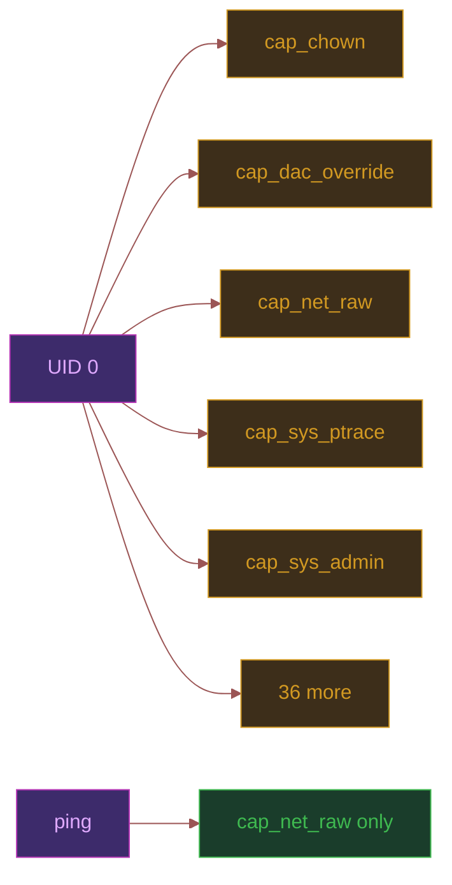
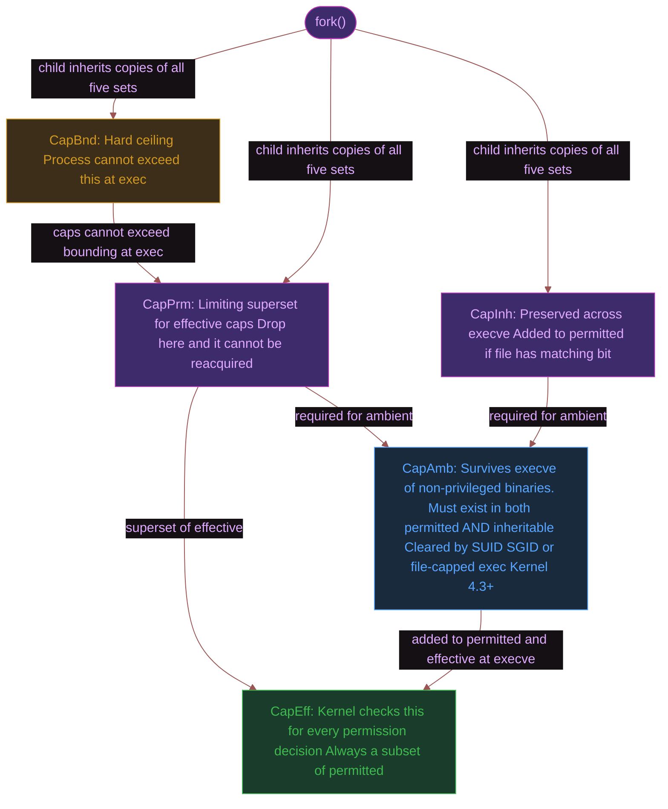
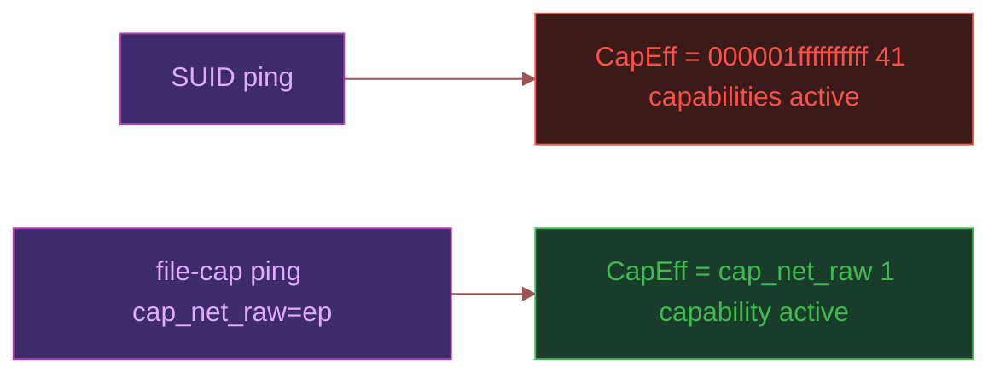
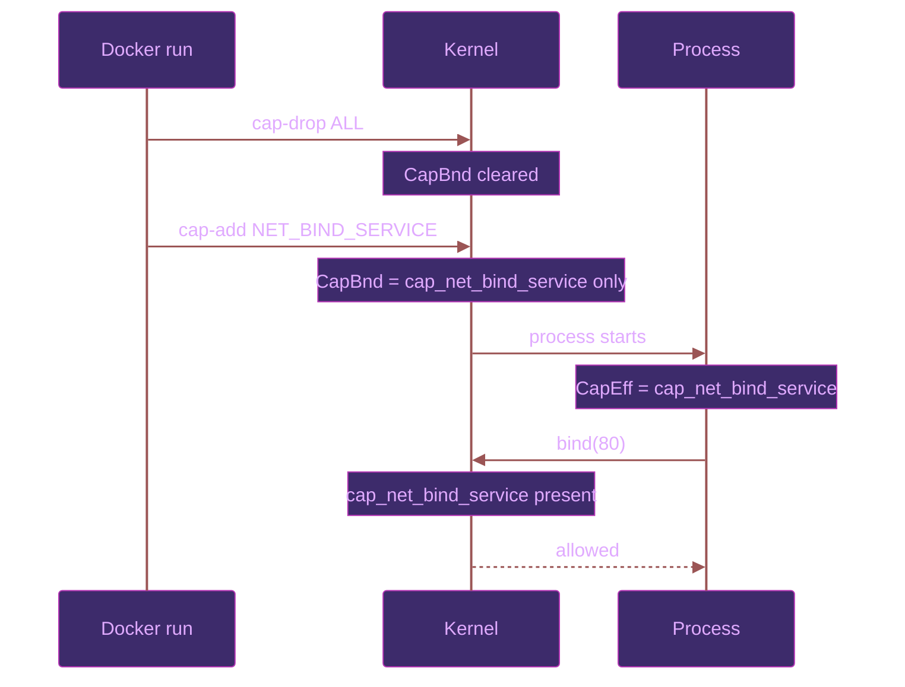
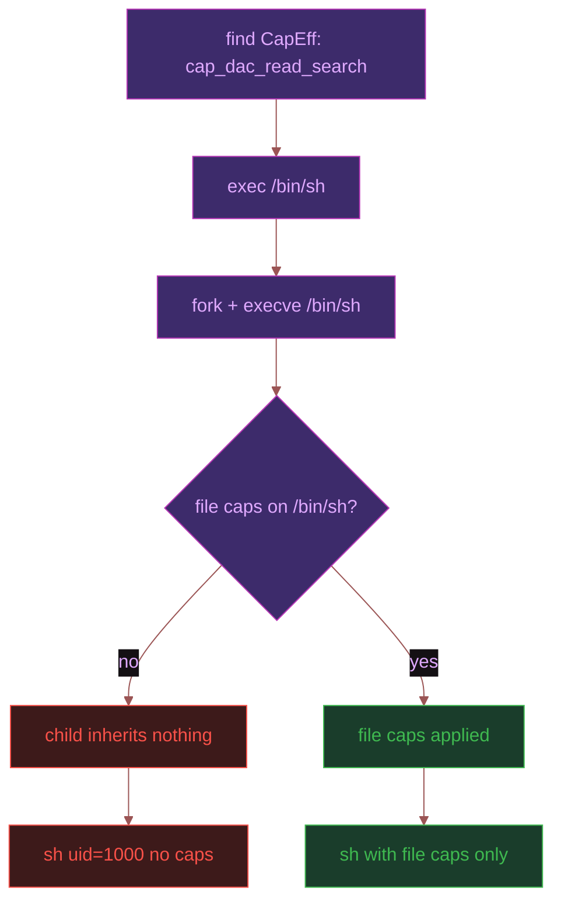

> _This is the third article in the Linux Privilege Internals series. [Part 1](https://shubhsec.dev/post/linux/linux-privilege-internals-part-1/) covered how Linux stores process identity. [Part 2](https://shubhsec.dev/post/linux/linux-privilege-internals-part-2/) showed how SUID grants privilege and what happens when a privileged program has a bug. This article breaks open what root actually is._

---

# Introduction

At the end of Part 2 we ran this inside the PwnKit shell:

```bash
capsh --decode=0000003fffffffff
```

And got back a list of names.

```text
cap_chown, cap_dac_override, cap_dac_read_search, cap_fowner, cap_fsetid, cap_kill, cap_setgid, cap_setuid, cap_setpcap, cap_net_bind_service, cap_net_raw, cap_sys_chroot, cap_sys_ptrace, cap_sys_admin, cap_sys_module ...
```

This is what root looks like, a bitmask of 41 individually named privileges that the kernel tracks for every process on the system.

This article is about looking at them. What they are, how the kernel uses them, why `find` with one capability is completely different from `find` with SUID root, and why running `GTFOBins` payloads without checking `getcap` first is a mistake.

---

# Unbundling The Root

The last two [articles](https://shubhsec.dev/categories/linux/) showed two things:

1. DAC only knows about users and groups. It has no concept of individual privileges. You are either root or you are not.
2. SUID solves this by swapping the entire effective identity of a process to the file owner. Need a raw socket? Give the binary SUID root. The binary now has 41 things when it needed one.

The question we didn't answer is: why are there 41 things in the first place?

Because the kernel has always tracked privileges individually. The separation has existed since kernel 2.2 in 1999. We just kept reaching for root instead of using it (not all of them were present, some were later additions)



Root gets all of them. A well-configured binary gets exactly one.


---

# Root Behind The Curtains

When the kernel checks whether a process can do something privileged, it checks whether the process has the specific capability required for that operation.

UID 0 just happens to get all capabilities by default. That is the entire special treatment root receives.

```bash
cat /proc/$$/status | grep Cap
capsh --print
```

For a root shell you will see `CapEff: 000001ffffffffff`. For a regular user shell you will see `CapEff: 0000000000000000`.

What the kernel sees is the effective `Capability set` for that process.

---

# Who Inherits What: The Five Set Matrix

Every process has five capability sets sitting in `struct cred` right next to the UIDs from Part 1.

```bash
CapInh  inheritable: preserved across execve
CapPrm  permitted: limiting superset for effective
CapEff  effective: kernel checks this
CapBnd  bounding: hard ceiling, a process cannot exceed
CapAmb  ambient: survives exec without file caps (kernel 4.3+)
```



Read them live:

```bash
cat /proc/$$/status | grep Cap
```

```bash
CapInh:	0000000000000000
CapPrm:	0000000000000000
CapEff:	0000000000000000
CapBnd:	000001ffffffffff
CapAmb:	0000000000000000
```

Decode any hex value:

```bash
capsh --decode=000001ffffffffff
```

The bounding set is non-zero even for a regular user. It is the ceiling of what the process could ever gain, not what it currently has.

One important note on `inheritance`: capabilities do not flow through exec automatically. When a process forks and execs a new binary, the child only gets capabilities if the binary has file capabilities set, or if the ambient set has been explicitly configured. The ambient set, added in kernel 4.3, exists specifically to fix this. **Any capability in the ambient set that is also in permitted and inheritable survives exec unconditionally.**

---

# Giving ping Scissors not a Chainsaw (we ain't Denji)

This is where the SUID problem from [my article on Linux SUID](https://shubhsec.dev/post/linux/linux-privilege-internals-part-2/) gets solved. Instead of marking a binary **SUID** root to get all 41 capabilities, you can mark a binary with the specific capability it actually needs.

```bash
# old way
ls -la /usr/bin/ping
-rwsr-xr-x 1 root root ... /usr/bin/ping
# CapEff = 000001ffffffffff (all 41)

# new way
getcap /usr/bin/ping
/usr/bin/ping cap_net_raw=ep
# CapEff has only CAP_NET_RAW
```

The `ep` after the capability name are the file capability flags:

- `e` effective: active immediately when the binary runs
- `p` permitted: enters the permitted set
- `i` inheritable: can be inherited across exec

For most binaries you will see `=ep`.



Attack surface went from 41 capabilities down to 1 (kinda).


---

# The Ecosystem Left Root Behind

Before going into the hands-on lab, it is worth noting that this model is not new. Docker, systemd, and Kubernetes all treat capabilities as the primitive unit of privilege. Most modern Linux security tools also look for them as a perimeter of security.

## Docker

```bash
docker run --cap-drop=ALL --cap-add=NET_BIND_SERVICE myapp
```

`--privileged` hands back all 41. That is why it is dangerous.


## systemd

```ini
[Service]
AmbientCapabilities=CAP_NET_BIND_SERVICE
CapabilityBoundingSet=CAP_NET_BIND_SERVICE
NoNewPrivileges=true
User=www-data
```

## Kubernetes

```yaml
securityContext:
  capabilities:
    drop:
      - ALL
    add:
      - NET_BIND_SERVICE
```



All three independently arrived at the same model. Capabilities are the primitive. Root is the shortcut (and a messy one).

---

# The GTFOBins Mirage

You are on a target system. You run:

```bash
find / -perm /4000 -type f 2>/dev/null
```

Nothing interesting comes back.

Then you run:

```bash
getcap -r / 2>/dev/null
```

And you see:

```text
/usr/bin/find cap_dac_read_search=ep
```

You open GTFOBins. `find` is listed. The payload is:

```bash
find . -exec /bin/sh \; -quit
```

You run it. You get a shell. You run `id`.

```text
uid=1000(user) gid=1000(user) groups=1000(user)
```

Still uid 1000. The payload **FAILED** .


Why?

## Absolute Sight, Zero Hands

`CAP_DAC_READ_SEARCH` does two things:

- Bypass `DAC` read permission checks on files
- Bypass `DAC` read and execute checks on directories

What it does not give you:

- Cannot change UID
- Cannot write to files
- Cannot execute things as a different user
- Has no effect on what child processes inherit

That last point is an important one.



When `find` runs `-exec /bin/sh`, it forks a child and execs `/bin/sh`. That child starts fresh. No file capabilities on `/bin/sh`. Inheritable set is empty. Ambient set is empty. The child gets nothing.

The GTFOBins payload assumes SUID root or a full capability set. With a scoped capability, it fails.

## Reading The Fine Print

Before running any GTFOBins payload, try to understand what the capability actually permits. `getcap` tells you what a binary has. There are no guarantees regarding its success.

```bash
getcap -r / 2>/dev/null
```

For each result ask two things: what does this capability actually allow, and does the GTFOBins payload require more than what this capability gives?

---

# Anatomy of a Mis-Find

On a typical Ubuntu system `getcap -r / 2>/dev/null` returns something like this:

```bash
/usr/bin/ping cap_net_raw=ep
/usr/bin/mtr-packet cap_net_raw=ep
/usr/bin/traceroute6.iputils cap_net_raw=ep
```

That is the full list on a clean install. No obvious escalation path.

The reference below shows what each capability actually permits and whether a GTFOBins exec payload is likely to work against it:

<div class="caps-ref not-prose my-8">
<style>
  .caps-ref {
    --caps-bg: hsl(var(--card) / 0.85);
    --caps-border: hsl(var(--border) / 0.6);
    --caps-border-hover: hsl(var(--border));
    --caps-text: hsl(var(--foreground));
    --caps-desc: hsl(var(--muted-foreground));
    --caps-hover-bg: hsl(var(--secondary) / 0.5);
    max-width: 100%;
    margin: 2rem 0;
    font-family: inherit;
  }
  .caps-ref * {
    box-sizing: border-box;
  }
  .caps-ref-header {
    margin-bottom: 1.25rem;
    display: flex;
    align-items: baseline;
    justify-content: space-between;
    gap: 0.75rem;
    flex-wrap: wrap;
  }
  .caps-ref-header h3 {
    font-size: 0.95rem;
    font-weight: 600;
    color: var(--caps-text);
    margin: 0;
  }
  .caps-ref-header p {
    font-size: 0.75rem;
    color: var(--caps-desc);
    margin: 0;
  }
  .caps-ref-grid {
    display: grid;
    grid-template-columns: repeat(4, 1fr);
    gap: 0.65rem;
  }
  @media (max-width: 900px) {
    .caps-ref-grid { grid-template-columns: repeat(2, 1fr); }
  }
  @media (max-width: 520px) {
    .caps-ref-grid { grid-template-columns: 1fr; }
  }
  .caps-card {
    background: var(--caps-bg);
    border: 1px solid var(--caps-border);
    border-top: 2px solid var(--accent);
    border-radius: 0.5rem;
    overflow: hidden;
    display: flex;
    flex-direction: column;
    backdrop-filter: blur(4px);
    transition: border-color 0.15s ease, transform 0.15s ease;
  }
  .caps-card:hover {
    border-color: var(--accent);
  }
  .caps-card-head {
    padding: 0.75rem 0.75rem 0.5rem;
    border-bottom: 1px solid var(--caps-border);
  }
  .caps-group-label {
    display: flex;
    align-items: center;
    gap: 0.45rem;
    font-size: 0.75rem;
    font-weight: 600;
    color: var(--accent);
    letter-spacing: 0.02em;
    text-transform: uppercase;
  }
  .caps-group-dot {
    width: 6px;
    height: 6px;
    border-radius: 50%;
    background: var(--accent);
    flex-shrink: 0;
  }
  .caps-risk {
    font-size: 0.68rem;
    color: var(--caps-desc);
    margin-top: 0.25rem;
    padding-left: 0.85rem;
    line-height: 1.3;
  }
  .caps-list {
    padding: 0.4rem 0;
    flex: 1;
  }
  .caps-item {
    padding: 0.35rem 0.75rem;
    cursor: default;
    transition: background-color 0.1s ease;
  }
  .caps-item:hover {
    background: var(--caps-hover-bg);
  }
  .caps-name {
    font-family: ui-monospace, SFMono-Regular, Menlo, Monaco, Consolas, "Liberation Mono", monospace;
    font-size: 0.68rem;
    font-weight: 600;
    color: var(--accent);
    opacity: 0.9;
    display: block;
    margin-bottom: 0.1rem;
    letter-spacing: -0.01em;
  }
  .caps-item:hover .caps-name {
    opacity: 1;
  }
  .caps-desc {
    font-size: 0.7rem;
    color: var(--caps-desc);
    line-height: 1.35;
    display: block;
  }
  .caps-item:hover .caps-desc {
    color: var(--caps-text);
  }
  /* Group accent colors */
  .caps-g-identity  { --accent: #9d8df8; }
  .caps-g-fs        { --accent: #60a5fa; }
  .caps-g-net       { --accent: #2dd4bf; }
  .caps-g-process   { --accent: #eab308; }
  .caps-g-kernel    { --accent: #f43f5e; }
  .caps-g-audit     { --accent: #fb923c; }
  .caps-g-ipc       { --accent: #34d399; }
  .caps-g-modern    { --accent: #38bdf8; }
</style>
<div class="caps-ref-header">
  <h3>Linux Capabilities Reference</h3>
  <p>Grouped by what they control</p>
</div>
<div class="caps-ref-grid">
  <div class="caps-card caps-g-identity">
    <div class="caps-card-head">
      <div class="caps-group-label"><span class="caps-group-dot"></span>Identity</div>
      <div class="caps-risk">Critical. Direct path to root.</div>
    </div>
    <div class="caps-list">
      <div class="caps-item"><span class="caps-name">CAP_SETUID</span><span class="caps-desc">Switch to any UID. setuid(0) gives root.</span></div>
      <div class="caps-item"><span class="caps-name">CAP_SETGID</span><span class="caps-desc">Switch to any GID.</span></div>
      <div class="caps-item"><span class="caps-name">CAP_SETPCAP</span><span class="caps-desc">Grant or drop caps in other processes.</span></div>
      <div class="caps-item"><span class="caps-name">CAP_CHOWN</span><span class="caps-desc">Change file ownership arbitrarily.</span></div>
      <div class="caps-item"><span class="caps-name">CAP_SETFCAP</span><span class="caps-desc">Set file capabilities on binaries.</span></div>
    </div>
  </div>
  <div class="caps-card caps-g-fs">
    <div class="caps-card-head">
      <div class="caps-group-label"><span class="caps-group-dot"></span>Filesystem</div>
      <div class="caps-risk">High. DAC does not apply.</div>
    </div>
    <div class="caps-list">
      <div class="caps-item"><span class="caps-name">CAP_DAC_OVERRIDE</span><span class="caps-desc">Bypass all DAC checks. Read, write, execute anything.</span></div>
      <div class="caps-item"><span class="caps-name">CAP_DAC_READ_SEARCH</span><span class="caps-desc">Bypass read and directory traversal. No write.</span></div>
      <div class="caps-item"><span class="caps-name">CAP_FOWNER</span><span class="caps-desc">Bypass checks when owner UID does not match.</span></div>
      <div class="caps-item"><span class="caps-name">CAP_FSETID</span><span class="caps-desc">Set SUID or SGID without being the file owner.</span></div>
      <div class="caps-item"><span class="caps-name">CAP_LINUX_IMMUTABLE</span><span class="caps-desc">Set or clear immutable and append-only attributes.</span></div>
      <div class="caps-item"><span class="caps-name">CAP_MKNOD</span><span class="caps-desc">Create block and character device files.</span></div>
      <div class="caps-item"><span class="caps-name">CAP_LEASE</span><span class="caps-desc">Establish leases on arbitrary files.</span></div>
    </div>
  </div>
  <div class="caps-card caps-g-net">
    <div class="caps-card-head">
      <div class="caps-group-label"><span class="caps-group-dot"></span>Network</div>
      <div class="caps-risk">Situational. Depends on configuration.</div>
    </div>
    <div class="caps-list">
      <div class="caps-item"><span class="caps-name">CAP_NET_BIND_SERVICE</span><span class="caps-desc">Bind to ports below 1024.</span></div>
      <div class="caps-item"><span class="caps-name">CAP_NET_RAW</span><span class="caps-desc">Raw sockets. ARP spoofing and sniffing.</span></div>
      <div class="caps-item"><span class="caps-name">CAP_NET_ADMIN</span><span class="caps-desc">Interfaces, routing, firewall, net namespaces.</span></div>
      <div class="caps-item"><span class="caps-name">CAP_NET_BROADCAST</span><span class="caps-desc">Socket broadcasts and multicast.</span></div>
    </div>
  </div>
  <div class="caps-card caps-g-process">
    <div class="caps-card-head">
      <div class="caps-group-label"><span class="caps-group-dot"></span>Process</div>
      <div class="caps-risk">High. Can target any process.</div>
    </div>
    <div class="caps-list">
      <div class="caps-item"><span class="caps-name">CAP_KILL</span><span class="caps-desc">Send signals to any process regardless of UID.</span></div>
      <div class="caps-item"><span class="caps-name">CAP_SYS_PTRACE</span><span class="caps-desc">Trace any process. Memory injection. Container escape.</span></div>
      <div class="caps-item"><span class="caps-name">CAP_SYS_NICE</span><span class="caps-desc">Set scheduling priority for any process.</span></div>
      <div class="caps-item"><span class="caps-name">CAP_SYS_RESOURCE</span><span class="caps-desc">Override rlimits for any process.</span></div>
      <div class="caps-item"><span class="caps-name">CAP_SYS_PACCT</span><span class="caps-desc">Enable or disable process accounting.</span></div>
    </div>
  </div>
  <div class="caps-card caps-g-kernel">
    <div class="caps-card-head">
      <div class="caps-group-label"><span class="caps-group-dot"></span>Kernel</div>
      <div class="caps-risk">Critical. Arbitrary kernel access.</div>
    </div>
    <div class="caps-list">
      <div class="caps-item"><span class="caps-name">CAP_SYS_ADMIN</span><span class="caps-desc">Mount, namespace, keyring, devices. Broadest cap.</span></div>
      <div class="caps-item"><span class="caps-name">CAP_SYS_MODULE</span><span class="caps-desc">Load and unload modules. Arbitrary kernel code.</span></div>
      <div class="caps-item"><span class="caps-name">CAP_SYS_RAWIO</span><span class="caps-desc">Raw I/O port access via ioperm and iopl.</span></div>
      <div class="caps-item"><span class="caps-name">CAP_SYS_BOOT</span><span class="caps-desc">Reboot and kexec into a new kernel.</span></div>
      <div class="caps-item"><span class="caps-name">CAP_SYS_TIME</span><span class="caps-desc">Set the system and hardware clock.</span></div>
      <div class="caps-item"><span class="caps-name">CAP_SYS_CHROOT</span><span class="caps-desc">Call chroot() to change root directory.</span></div>
      <div class="caps-item"><span class="caps-name">CAP_SYS_LOG</span><span class="caps-desc">syslog and kernel message ring buffer.</span></div>
      <div class="caps-item"><span class="caps-name">CAP_SYS_TTY_CONFIG</span><span class="caps-desc">TTY configuration and virtual console control.</span></div>
    </div>
  </div>
  <div class="caps-card caps-g-audit">
    <div class="caps-card-head">
      <div class="caps-group-label"><span class="caps-group-dot"></span>Audit and Security</div>
      <div class="caps-risk">High. Can disable MAC enforcement.</div>
    </div>
    <div class="caps-list">
      <div class="caps-item"><span class="caps-name">CAP_AUDIT_CONTROL</span><span class="caps-desc">Enable or disable kernel audit. Change filter rules.</span></div>
      <div class="caps-item"><span class="caps-name">CAP_AUDIT_READ</span><span class="caps-desc">Read the audit log via netlink socket.</span></div>
      <div class="caps-item"><span class="caps-name">CAP_AUDIT_WRITE</span><span class="caps-desc">Write records to the kernel audit log.</span></div>
      <div class="caps-item"><span class="caps-name">CAP_MAC_ADMIN</span><span class="caps-desc">Override MAC. Bypasses Smack policy.</span></div>
      <div class="caps-item"><span class="caps-name">CAP_MAC_OVERRIDE</span><span class="caps-desc">Override MAC entirely. Bypasses AppArmor and SELinux.</span></div>
    </div>
  </div>
  <div class="caps-card caps-g-ipc">
    <div class="caps-card-head">
      <div class="caps-group-label"><span class="caps-group-dot"></span>IPC and Memory</div>
      <div class="caps-risk">Low. No clear escalation path.</div>
    </div>
    <div class="caps-list">
      <div class="caps-item"><span class="caps-name">CAP_IPC_LOCK</span><span class="caps-desc">Lock memory pages into RAM. Prevents swapping.</span></div>
      <div class="caps-item"><span class="caps-name">CAP_IPC_OWNER</span><span class="caps-desc">Bypass IPC checks for shared memory and semaphores.</span></div>
      <div class="caps-item"><span class="caps-name">CAP_BLOCK_SUSPEND</span><span class="caps-desc">Prevent the system from entering suspend.</span></div>
      <div class="caps-item"><span class="caps-name">CAP_WAKE_ALARM</span><span class="caps-desc">Trigger wake alarms from suspend state.</span></div>
    </div>
  </div>
  <div class="caps-card caps-g-modern">
    <div class="caps-card-head">
      <div class="caps-group-label"><span class="caps-group-dot"></span>Modern</div>
      <div class="caps-risk">Situational. Split from CAP_SYS_ADMIN in 5.8.</div>
    </div>
    <div class="caps-list">
      <div class="caps-item"><span class="caps-name">CAP_PERFMON</span><span class="caps-desc">Performance monitoring. perf_event_open. Kernel 5.8.</span></div>
      <div class="caps-item"><span class="caps-name">CAP_BPF</span><span class="caps-desc">Privileged BPF. Kernel memory reads possible. 5.8.</span></div>
      <div class="caps-item"><span class="caps-name">CAP_CHECKPOINT_RESTORE</span><span class="caps-desc">Checkpoint and restore process state. Kernel 5.9.</span></div>
    </div>
  </div>
</div>
</div>

## Setup

Two versions of find. One with `CAP_DAC_READ_SEARCH` only and one with SUID root. Let's see how they vary in their behaviour.

```bash
cp /usr/bin/find /tmp/find_cap
cp /usr/bin/find /tmp/find_suid
sudo setcap cap_dac_read_search=ep /tmp/find_cap
sudo chown root:root /tmp/find_suid
sudo chmod u+s /tmp/find_suid
getcap /tmp/find_cap
ls -la /tmp/find_suid
```

```bash
/tmp/find_cap cap_dac_read_search=ep
-rwsr-xr-x 1 root root ... /tmp/find_suid
```

## Test 1: Reading Protected Files

```bash
sudo bash -c 'echo "secret" > /tmp/secret.txt && chmod 600 /tmp/secret.txt && chown root:root /tmp/secret.txt'
/tmp/find_cap /tmp -name "secret.txt" 2>/dev/null
/tmp/find_suid /tmp -name "secret.txt" 2>/dev/null
```

Both find it. `CAP_DAC_READ_SEARCH` bypasses the directory read check.

## Test 2: The Payload That Leaves You Empty-Handed

```bash
/tmp/find_cap . -exec /bin/sh \; -quit
id
cat /proc/$$/status | grep Cap
exit

/tmp/find_suid . -exec /bin/sh \; -quit
id
cat /proc/$$/status | grep Cap
exit
```

`find_cap` gives uid=1000 and all-zero caps. `find_suid` gives uid=0 and full caps. Same binary. Same payload. Completely different privilege scope.

## Test 3: Inspect Running Capability Sets

```bash
# terminal 1
/tmp/find_cap / -name "*.conf" 2>/dev/null

# terminal 2
ps aux | grep find
cat /proc/<PID>/status | grep Cap
capsh --decode=$(cat /proc/<PID>/status | grep CapEff | awk '{print $2}')
```

`find_cap` shows only `cap_dac_read_search` in `CapEff`. `find_suid` shows `000001ffffffffff` and all 41 names.

---

# Sledgehammers Are Still Sledgehammers (albeit small)

Capabilities solve the granularity problem that SUID could not.

A process with `CAP_NET_RAW` can create raw sockets and nothing else. If it has a vulnerability, an attacker gets raw socket access. Not root. Not `CAP_SYS_ADMIN`. Not the ability to read `/etc/shadow`. But there is still a problem (these seem to never end).

A process with `CAP_DAC_READ_SEARCH` can read any file on the filesystem. The kernel has no concept of which files it should be allowed to read. The capability is binary: either the process has it, or it does not.

If you want to say "this process can read /var/log/app.log but not /etc/shadow", capabilities cannot express that. That requires a different layer. One that sits above DAC and capabilities and enforces policy on individual operations rather than granting broad privilege classes.


That layer is Mandatory Access Control and the Linux Security Module framework. We will cover this a bit later (I promise :])

---

# Unrooting The Primitive

Root is a bundle of 41 individually named privileges.

The kernel has for a long time now thought in terms of capabilities. `UID 0` just happens to get all of them by default. That is the entire special treatment root receives.

File capabilities let you give a binary exactly the one capability it needs. `ping` needs `CAP_NET_RAW`. A web server needs `CAP_NET_BIND_SERVICE`.

`getcap -r / 2>/dev/null` tells you more than `find / -perm /4000` because a `capability-scoped` binary has a completely different attack surface than a `SUID` root binary, and the `GTFOBins` payload that works on one will silently fail on the other.

The primitive is the capability. Root is something that is all-encompassing and also all destroying ;].

Now the usage of capabilities was not widely adopted. `Capabilities` solve the granularity problem. But they were not always available and not always easy to configure correctly. Before `setcap` was common, engineers solved this the hard way: start as root, do the privileged thing, fork, and drop. In the next article we look into how `Apache` and `nginx` handled privilege before capabilities existed, why that model worked, and exactly where it broke.

---

# References

- [man 7 capabilities](https://man7.org/linux/man-pages/man7/capabilities.7.html)
- [man 8 setcap](https://man7.org/linux/man-pages/man8/setcap.8.html)
- [man 8 getcap](https://man7.org/linux/man-pages/man8/getcap.8.html)
- [man 1 capsh](https://man7.org/linux/man-pages/man1/capsh.1.html)
- [man 2 prctl](https://man7.org/linux/man-pages/man2/prctl.2.html)
- [Credentials in Linux, kernel.org](https://docs.kernel.org/security/credentials.html)
- [include/linux/capability.h, kernel source](https://github.com/torvalds/linux/blob/master/include/linux/capability.h)
- [Linux Capabilities in OpenShift, Red Hat](https://www.redhat.com/en/blog/linux-capabilities-in-openshift)
- [Linux Capabilities and Seccomp, Red Hat Docs](https://docs.redhat.com/en/documentation/red_hat_enterprise_linux_atomic_host/7/html/container_security_guide/linux_capabilities_and_seccomp)
- [Playing with Linux Capabilities, ilmanzo](https://ilmanzo.github.io/post/playing_with_linux_capabilities/)
- [Linux Capabilities Privilege Escalation, HackTricks](https://book.hacktricks.xyz/linux-hardening/privilege-escalation/linux-capabilities)
- [GTFOBins Capabilities](https://gtfobins.github.io/#+capabilities)
- [Linux Privilege Internals Part 1](https://shubhsec.dev/post/linux/linux-privilege-internals-part-1/)
- [Linux Privilege Internals Part 2](https://shubhsec.dev/post/linux/linux-privilege-internals-part-2/)
